<p align="center"></p>

<h1 align="center">GiraffeUI</h1>

<p align="center">
    <strong>Free, accessible Blade + Alpine components for Laravel and Tailwind CSS v4.</strong><br>
    69 components built on native HTML: dialogs, popovers and anchor positioning first, Alpine only where the browser has nothing.<br>
    Works great with Livewire, but never requires it.
</p>

<p align="center">
    <a href="https://github.com/Jarryd-W-Hoffman/giraffe-ui/actions/workflows/tests.yml"></a>
    
    
    
    
    
</p>

<p align="center">
    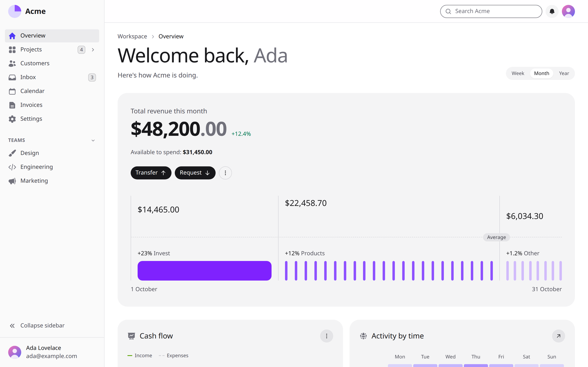
</p>

<p align="center">
    <a href="#why-giraffeui">Why GiraffeUI?</a> ·
    <a href="#features">Features</a> ·
    <a href="#examples">Examples</a> ·
    <a href="#installation">Installation</a> ·
    <a href="#usage">Usage</a> ·
    <a href="#components">Components</a> ·
    <a href="#theming">Theming</a> ·
    <a href="#how-its-built">How it's built</a> ·
    <a href="#development">Development</a> ·
    <a href="#license">License</a>
</p>

> **Status:** early development (pre-1.0). Expect breaking changes between minor versions until 1.0.

---

## Why GiraffeUI?

- **The platform first.** Modals are `<dialog>`, menus and popovers use the popover API and CSS anchor positioning, and they open with `command`/`commandfor` buttons. None of that needs JavaScript. [Alpine](https://alpinejs.dev) fills in only where the browser has nothing (tabs, the combobox, the date picker's calendar, toasts).
- **Accessible by default.** Every catalog page is audited with axe against WCAG 2.2 AA, in light and dark mode, on every change. Every default colour pairing meets 4.5:1 contrast. Keyboard support follows the WAI-ARIA patterns.
- **Livewire optional, never required.** `wire:model`, loading states and morphing just work, but nothing in GiraffeUI calls Livewire. CI runs the whole suite a second time with Livewire removed to keep it that way.
- **Plain Blade, plain Tailwind.** Attributes pass straight through, slots replace HTML strings, and theming is CSS variables. There's no PHP config and no build step of its own.

## Features

### 🧩 69 components

Forms, overlays, navigation, data tables, charts and marketing sections, all sharing the same props (`variant`, `color`, `size`) and the same look. See the [full list](#components).

<p align="center">
    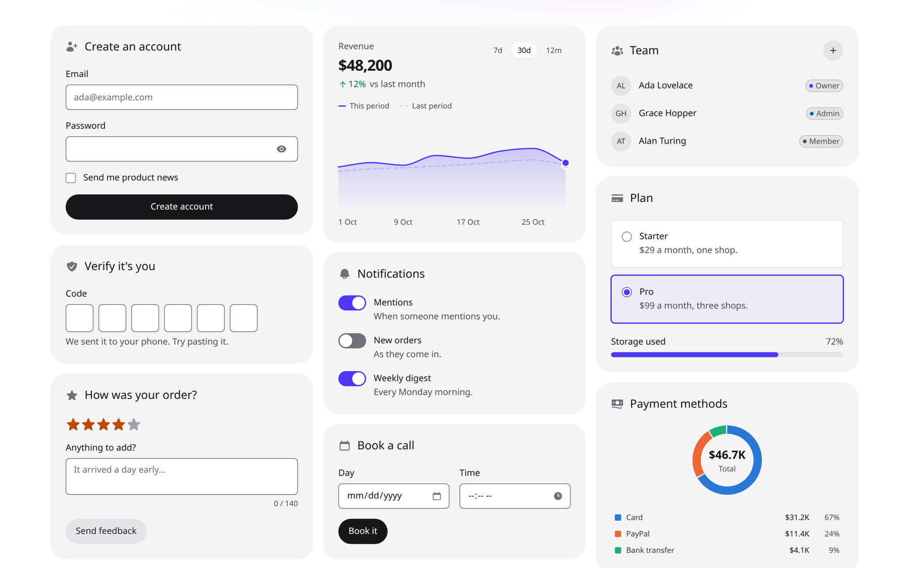
</p>

### 📝 Forms that wire themselves up
- **Fields:** wrap a control in `<x-gui::field>` and it gets its `id`, `name`, label, hint, `aria-describedby` and `aria-invalid`.
- **Validation:** errors come from Laravel's `$errors` bag, and old input is refilled after a failed submission.
- **Rich controls on native inputs:** combobox (with server search), date, time and date-range pickers, OTP input, file upload, number input, slider, rating, swatches and segmented controls. A real `<input>` sits underneath each one, so forms, autofill and screen readers behave as usual.

### 🪟 Overlays without the JavaScript
- **Modal and drawer:** native `<dialog>`, with focus trapping and <kbd>Esc</kbd> handled by the browser.
- **Dropdown, popover and tooltip:** the popover API, positioned with CSS anchor positioning. Dropdowns support submenus, checkbox and radio items, and arrow keys.
- **Command palette:** a <kbd>⌘</kbd><kbd>K</kbd> search for your app, grouped and filterable.
- **Toasts:** from Alpine, a Livewire event, or a session flash after a redirect.

<p align="center">
    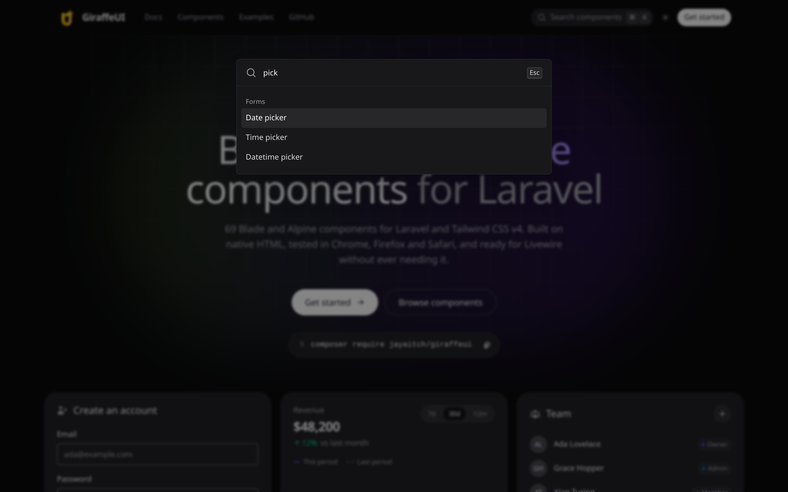
</p>

### 📊 Charts in pure SVG
Line, area, bar, donut, scatter, heatmap, bar list and sparkline charts, rendered on the server as SVG. No charting library. Each one comes with a legend and an accessible data table, numbers are formatted for the app's locale, and charts resize with their container.

### 🎨 Themes and dark mode
- **CSS variables only:** set `--color-gui-primary` and `--radius-gui` in your own `@theme` block and every component follows.
- **Dark mode** through Tailwind's `dark:` variant, with a theme switcher and a layout that sets the theme before the page paints.
- **Translations:** built-in text ("Close", "No results", "Choose date") comes from Laravel's translator.

<p align="center">
    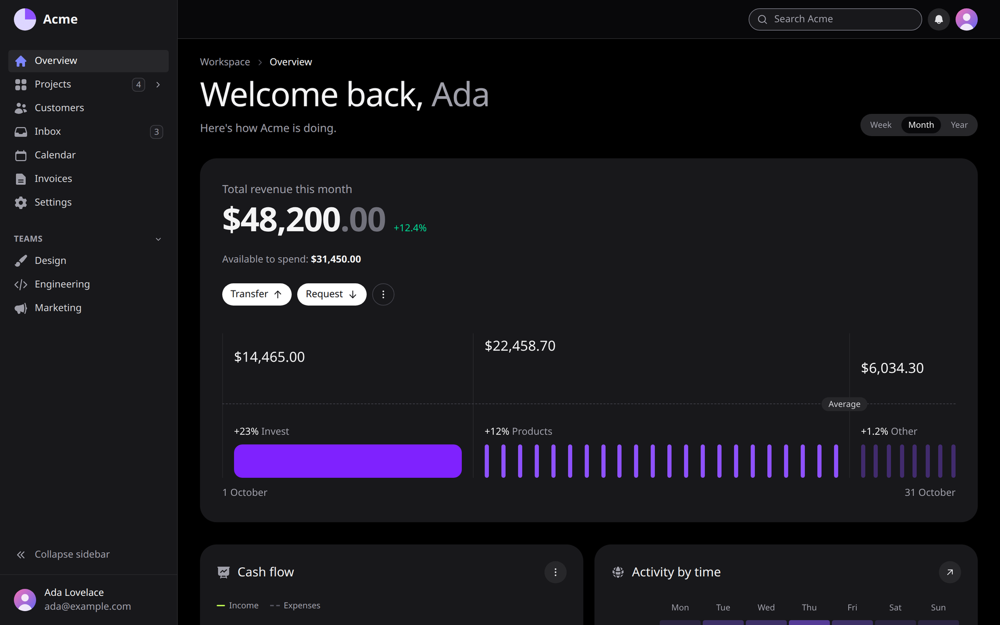
</p>

### 🔍 A catalog to try everything
A docs site, like shadcn/ui's, with a live **playground** for each component (the real component, re-rendered on the server as you change props), examples with Preview and Code tabs, an API reference, and a **theme customiser** that writes your `@theme` overrides for you.

<p align="center">
    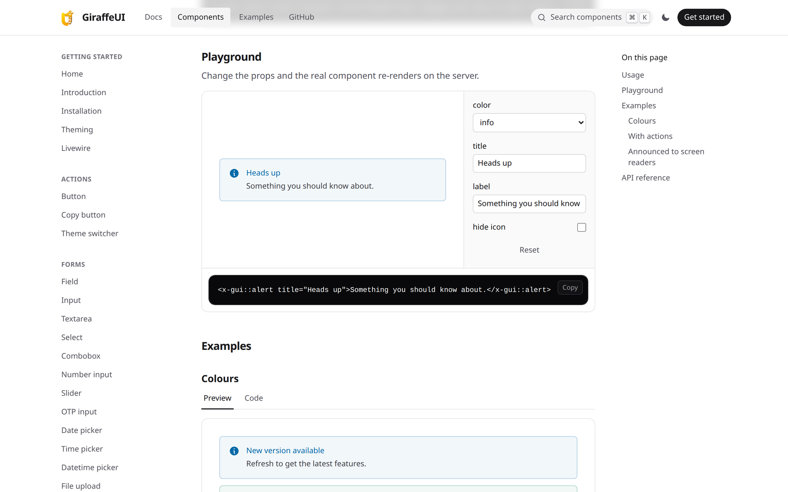
    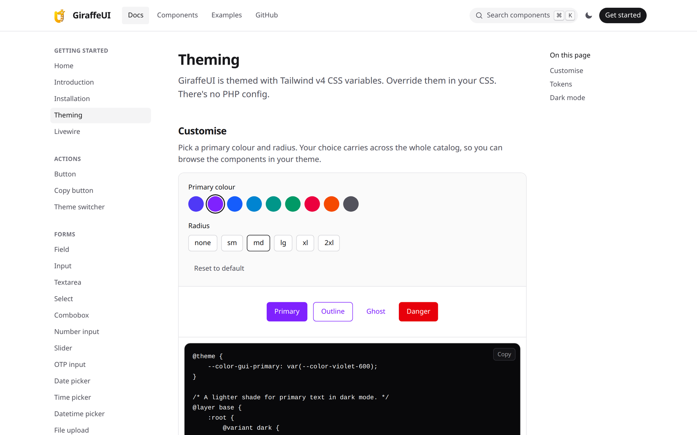
</p>

Run it locally with `composer catalog` (see [Development](#development)).

## Examples

The catalog includes 13 full pages built only from GiraffeUI components: Dashboard, Projects, Inbox, Calendar, Invoice, Store, Customers, Sign in, Register, Forgot password, Onboarding, Pricing and Not found. Their source is in [`workbench/resources/views/examples`](workbench/resources/views/examples), ready to copy.

<p align="center">
    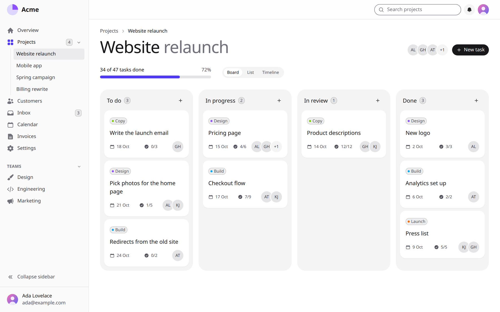
    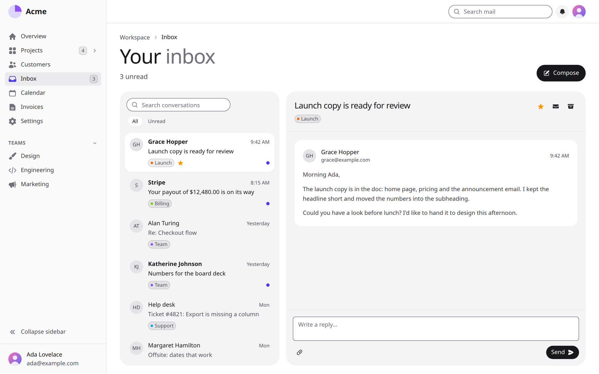
</p>

<p align="center">
    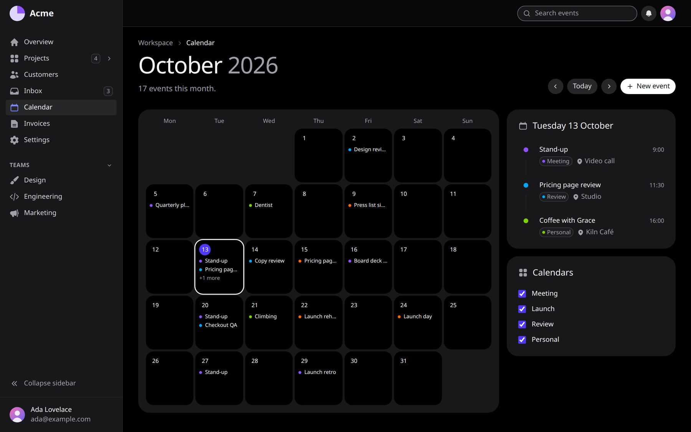
    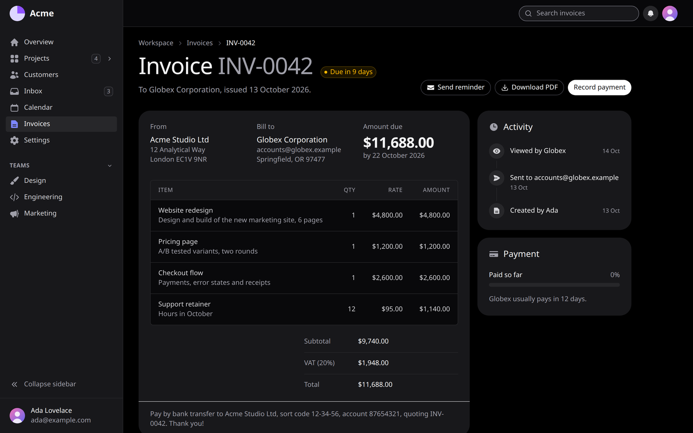
</p>

<p align="center">
    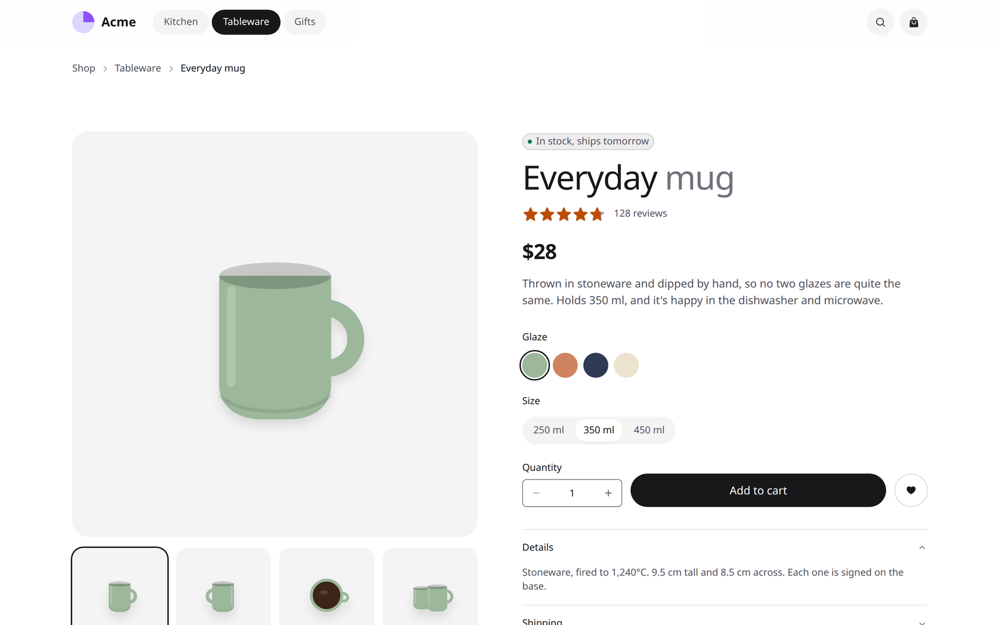
    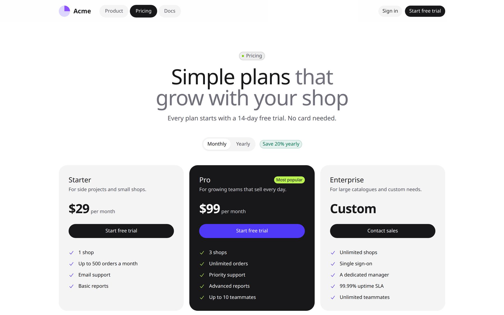
</p>

<p align="center">
    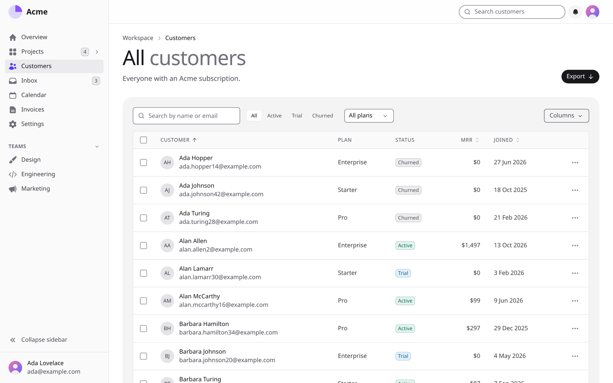
    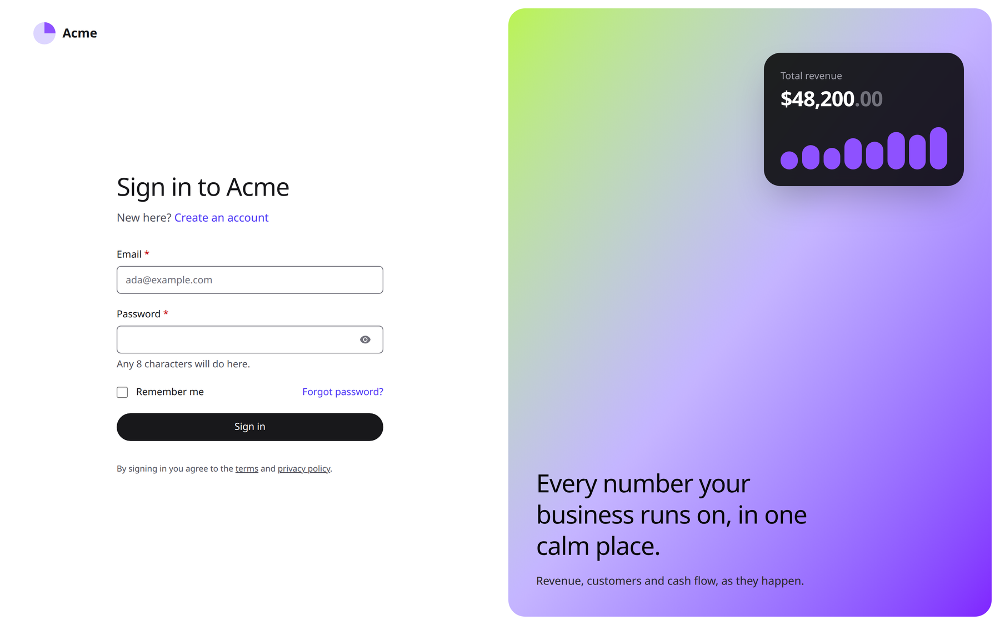
</p>

## Installation

### Requirements

- PHP 8.4+
- Laravel 13
- Tailwind CSS v4 (new Laravel apps already have it)
- [Alpine](https://alpinejs.dev) for the interactive parts. Livewire includes it; Livewire itself is optional.
- Current Chrome, Edge, Firefox or Safari (see [Browser support](#browser-support))

### Install

```bash
composer require jayaitch/giraffeui
php artisan gui:install
```

The installer:

1. adds GiraffeUI's CSS to `resources/css/app.css`, right after `@import "tailwindcss"`;
2. offers to install Livewire (optional, off by default);
3. without Livewire, offers to start Alpine in `resources/js/app.js` and tells you to run `npm install alpinejs`;
4. offers to publish an app layout with dark mode and toasts at `resources/views/components/layouts/app.blade.php`. If you already have one, you can install it under another name, overwrite it, or skip.

It is safe to run again. It never runs npm or edits Tailwind config files.

### Manual installation

Add one line to `resources/css/app.css`:

```css
@import "tailwindcss";
@import "../../vendor/jayaitch/giraffeui/resources/css/giraffeui.css";
```

Then rebuild your CSS (`npm run dev` or `npm run build`).

Without Livewire, also start Alpine in `resources/js/app.js` (after `npm install alpinejs`):

```js
import Alpine from 'alpinejs';

window.Alpine = Alpine;
Alpine.start();
```

## Usage

```blade
<x-gui::button color="success" wire:click="save">Save</x-gui::button>

<x-gui::table :columns="['name', 'email']" :rows="$users" />
```

### Forms

Wrap a control in a field to get a linked label, hint and error message. Errors come from Laravel's `$errors` bag, using the field's `name`:

```blade
<form method="POST" action="/profile">
    @csrf

    <x-gui::field label="Email" name="email" hint="We'll never share it." required>
        <x-gui::input type="email" />
    </x-gui::field>

    <x-gui::button type="submit">Save</x-gui::button>
</form>
```

The input gets `id`, `name`, `required`, `aria-invalid` and `aria-describedby` automatically, and is refilled with old input after a failed submission. With Livewire, put `wire:model` on the control and keep `name` on the field. Buttons that trigger Livewire requests show a loading spinner on their own.

### Interactivity

Modal, Dropdown and Popover open with `command`/`commandfor` buttons, with no JavaScript. Accordion is native `<details>`. Where the browser has no built-in behaviour, GiraffeUI uses Alpine. Livewire includes Alpine; in other apps, the installer can add it.

```blade
<x-gui::button commandfor="confirm" command="show-modal">Delete</x-gui::button>

<x-gui::modal id="confirm" title="Delete project?">
    <x-slot:footer>
        <x-gui::modal.close>Cancel</x-gui::modal.close>
        <x-gui::button color="danger">Delete</x-gui::button>
    </x-slot:footer>
</x-gui::modal>
```

### Conventions

Every component follows the same rules:

- **Props:** `variant` (`solid`, `outline`, `ghost`), `color` (`primary`, `secondary`, `success`, `warning`, `danger`, `info`), `size` (`sm`, `md`, `lg`).
- **Attributes pass through.** `class`, `wire:*`, `x-*`, `data-*` and anything else lands on the component's main element.
- **Override built-in classes with `!`.** Your classes are added to the component's own, and when two set the same property, the order in the stylesheet decides which wins, not the order you wrote them. To replace one, use Tailwind's important modifier: `<x-gui::button class="px-0!">`, `<x-gui::skeleton class="rounded-full!">`.
- **Slots, not HTML strings,** for icons and other parts (e.g. `<x-slot:leading>`).
- **Theming is CSS variables only.** There is no PHP config.

### Translations

Built-in text such as "Close", "No results" or "Choose date" comes from Laravel's translator and follows your app's locale. To translate or reword it:

```bash
php artisan vendor:publish --tag=giraffeui-lang
```

Then copy `lang/vendor/giraffeui/en/ui.php` to your locale (e.g. `fr/ui.php`) and translate it. Props such as `button-label` still win when you pass them.

### Browser support

GiraffeUI targets current versions of Chrome, Edge, Firefox and Safari. It builds on `<dialog>`, the popover API, CSS anchor positioning (Baseline since January 2026) and invoker commands (`command`/`commandfor`). Older browsers without them can't open modals, menus or popovers. Every change is tested automatically in Chromium, Firefox and WebKit (the engine behind Safari).

## Components

Each link goes to the component's docs: usage, examples and every prop. They're generated from the catalog, so they always match it.

| Group | Components |
|---|---|
| Actions | [Button](docs/components/button.md), [Copy button](docs/components/copy-button.md), [Theme switcher](docs/components/theme-switcher.md) |
| Forms | [Field](docs/components/field.md), [Input](docs/components/input.md), [Textarea](docs/components/textarea.md), [Select](docs/components/select.md), [Combobox](docs/components/combobox.md), [Number input](docs/components/number-input.md), [Slider](docs/components/slider.md), [Date picker](docs/components/date-picker.md), [Time picker](docs/components/time-picker.md), [Datetime picker](docs/components/datetime-picker.md), [OTP input](docs/components/otp-input.md), [File upload](docs/components/file-upload.md), [Checkbox](docs/components/checkbox.md), [Radio](docs/components/radio.md), [Rating](docs/components/rating.md), [Swatches](docs/components/swatches.md), [Segmented control](docs/components/segmented-control.md), [Switch](docs/components/switch.md), [Fieldset](docs/components/fieldset.md), [Label](docs/components/label.md) |
| Display | [Alert](docs/components/alert.md), [Banner](docs/components/banner.md), [Icon](docs/components/icon.md), [Avatar](docs/components/avatar.md), [Avatar group](docs/components/avatar-group.md), [Badge](docs/components/badge.md), [Card](docs/components/card.md), [Description list](docs/components/description-list.md), [Timeline](docs/components/timeline.md), [Code block](docs/components/code-block.md), [Snippet](docs/components/snippet.md), [Stat](docs/components/stat.md), [Separator](docs/components/separator.md), [Spinner](docs/components/spinner.md), [Progress](docs/components/progress.md), [Kbd](docs/components/kbd.md), [Skeleton](docs/components/skeleton.md), [Empty state](docs/components/empty-state.md) |
| Charts | [Line chart](docs/components/line-chart.md), [Area chart](docs/components/area-chart.md), [Bar chart](docs/components/bar-chart.md), [Donut chart](docs/components/donut-chart.md), [Bar list](docs/components/bar-list.md), [Scatter chart](docs/components/scatter-chart.md), [Heatmap](docs/components/heatmap.md), [Sparkline](docs/components/sparkline.md) |
| Navigation | [Navbar](docs/components/navbar.md), [Sidebar](docs/components/sidebar.md), [Breadcrumbs](docs/components/breadcrumbs.md), [Stepper](docs/components/stepper.md) |
| Overlays | [Modal](docs/components/modal.md), [Drawer](docs/components/drawer.md), [Command palette](docs/components/command-palette.md), [Dropdown](docs/components/dropdown.md), [Popover](docs/components/popover.md), [Tooltip](docs/components/tooltip.md), [Toast](docs/components/toasts.md) |
| Disclosure | [Accordion](docs/components/accordion.md), [Tabs](docs/components/tabs.md) |
| Marketing | [Announcement](docs/components/announcement.md), [Backdrop](docs/components/backdrop.md), [Feature](docs/components/feature.md), [Page preview](docs/components/page-preview.md), [Footer](docs/components/footer.md) |
| Data | [Table](docs/components/table.md), [Pagination](docs/components/pagination.md) |

## Theming

Override any token in your own `@theme` block, after the GiraffeUI import:

```css
@theme {
    --color-gui-primary: var(--color-violet-600);
    --color-gui-primary-foreground: var(--color-white);
    --radius-gui: var(--radius-lg);
}
```

| Token | Default |
|---|---|
| `--color-gui-primary` | indigo-600 |
| `--color-gui-secondary` | zinc-600 |
| `--color-gui-success` | emerald-700 |
| `--color-gui-warning` | amber-400 |
| `--color-gui-danger` | red-600 |
| `--color-gui-info` | sky-700 |
| `--color-gui-input` | zinc-500 (input borders and switch tracks) |
| `--radius-gui` | `--radius-md` |

Each colour has three tokens:

- `--color-gui-{name}`: solid backgrounds.
- `--color-gui-{name}-foreground`: text on a solid background.
- `--color-gui-{name}-text`: text, borders and focus rings on the page background. Dark mode uses a lighter shade.

Every default pairing meets WCAG AA (4.5:1) in light and dark mode. If you change a colour, set its dark-mode text shade too:

```css
@layer base {
    :root {
        @variant dark {
            --color-gui-primary-text: var(--color-violet-400);
        }
    }
}
```

### Dark mode

Components use Tailwind's `dark:` variant. By default Tailwind follows the OS setting. The published layout switches to class-based dark mode instead. It adds `@custom-variant dark (&:where(.dark, .dark *));` to your CSS and sets the `.dark` class before the page paints, using the saved choice or the OS setting. Switch themes from anywhere with:

```js
GiraffeUI.setTheme('dark'); // or 'light', or 'system'
```

## How it's built

| Layer | Technology |
| --- | --- |
| Components | Anonymous [Blade](https://laravel.com/docs/blade) components, plus class components where children need their parent's state |
| Behaviour | `<dialog>`, the popover API, CSS anchor positioning and invoker commands; [Alpine](https://alpinejs.dev) where the platform has nothing |
| Styling | [Tailwind CSS v4](https://tailwindcss.com) with CSS-variable tokens, logical (`start`/`end`) classes and container queries |
| Charts | SVG rendered on the server, with no charting library |
| Catalog | [Testbench Workbench](https://packages.tools/workbench), in `workbench/` and not shipped with the package |
| Tests | [Pest](https://pestphp.com), [Playwright](https://playwright.dev) in Chromium, Firefox and WebKit, [axe-core](https://github.com/dequelabs/axe-core), PHPStan with Larastan |

## Development

```bash
composer install
npm install
composer test        # Pest
composer lint        # Pint
composer analyse     # PHPStan
composer catalog     # Build the catalog's CSS and serve it at http://localhost:8000/catalog
composer docs        # Regenerate docs/components from the catalog
npm run audit:a11y   # With the catalog running: axe-core on every page, light and dark
npm run test:browser # With the catalog running: drives the Alpine components in Chrome (BROWSER=firefox or webkit)
```

CI runs everything twice: with Livewire, and with Livewire removed and Alpine loaded on its own, so GiraffeUI never comes to depend on Livewire.

### Catalog

The catalog runs on [Testbench Workbench](https://packages.tools/workbench) and lives in `workbench/`. To add a component, add an entry to `workbench/app/Catalog.php`, then run `composer docs`; the Markdown in `docs/components` is generated from the catalog, and CI fails if it's out of date. Example code is rendered as-is, so what you read is exactly what ran. While editing styles, run `npm run catalog:watch` in a second terminal.

### Contributing

Pull requests are welcome. See [CONTRIBUTING.md](CONTRIBUTING.md). Please report security issues privately, as described in [SECURITY.md](SECURITY.md).

## License

GiraffeUI is open-source software licensed under the [MIT license](LICENSE).
